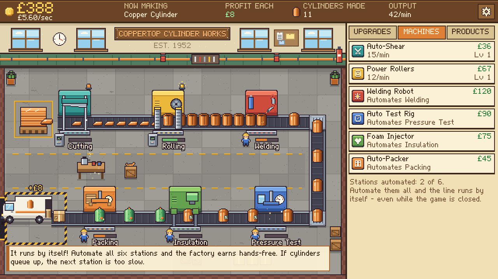
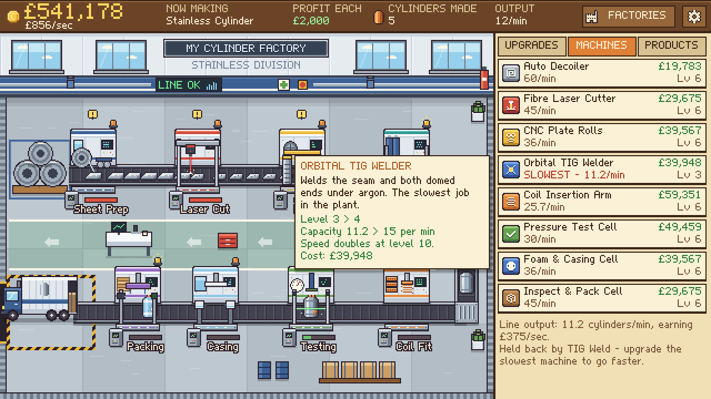

# Cylinder Clicker

A cosy 2D pixel-art factory idle game. You run **Coppertop Cylinder Works**, a small British
hot water cylinder factory that you name yourself: click to work the line, sell copper cylinders, buy machines and
watch the factory slowly learn to run itself.

Built with **Godot 4.7 + GDScript**. Runs on **Windows** and **Android** (landscape) from the same
code. Fully offline, local saves only, no ads, no accounts, no third-party assets.





## How to play it

**Easiest: download from the Releases page**

Open the repository's **Releases** page on GitHub and pick the latest release.

- **Android phone or tablet:** download `CylinderClicker-<version>-android.apk` on the phone and open
  it. The first time, Android asks you to allow your browser (or Files app) to install apps - allow
  it, then tap Install. The game is landscape only, needs no permissions and works offline.
- **Windows:** download `CylinderClicker-<version>-windows.zip`, unzip it and double-click
  `CylinderClicker.exe`. Windows may show a "Windows protected your PC" notice because the exe is
  not code-signed: choose *More info* > *Run anyway*.

Every push also builds both versions: open the **Actions** tab, pick the latest green run and
download the `CylinderClicker-android` or `CylinderClicker-windows` artifact.

**Run from the project**

1. Download Godot **4.7.x** (standard version) from <https://godotengine.org/download/windows/>.
   It is a single exe - no installer.
2. Start Godot, choose **Import**, select this folder's `project.godot`, then press **F5**.

### Moving a save between Windows and Android

Saves are stored separately on each device (`%APPDATA%\CylinderClicker\savegame.json` on Windows,
the app's private storage on Android). To carry a factory across:

1. On the old device open the main menu, choose **Transfer Save** > **Copy save code**.
2. Paste the code into an email or message to yourself.
3. On the new device copy that code, open **Transfer Save** and choose **Paste save code**.

The old device keeps its save; nothing is deleted.

### Android signing

Android only lets a new APK update an installed one if both are signed with the same key. The
release APKs are signed with the project's permanent key, which is **not** stored in this
repository. To let GitHub sign builds with it, add these repository secrets
(Settings > Secrets and variables > Actions):

| Secret | Value |
| --- | --- |
| `ANDROID_KEYSTORE_BASE64` | the keystore file, base64-encoded |
| `ANDROID_KEYSTORE_PASSWORD` | the keystore password |
| `ANDROID_KEY_ALIAS` | `cylinderclicker` |

Without them, builds from the Actions tab are signed with a throw-away key and named
`...-android-testkey.apk`; a Release then publishes the pre-signed APK from `releases/android/`
for that version if there is one. Once the secrets are set, `releases/android/` is no longer needed.

## Controls

On Android everything is done by touch: tap the factory to work (two thumbs both count), tap a
shop row to buy, **press and hold a row** for its details, drag the shop to scroll, and use the
phone's **Back** button or gesture for the pause menu.

| Input | Action |
| --- | --- |
| Left-click the factory floor, or **Space** | Work every station (the core click) |
| Click a shop row | Buy that upgrade / machine |
| Hover a shop row | Tooltip with what it does and what the next level gives |
| **1 / 2 / 3** | Upgrades / Machines / Products tabs |
| **F** or the FACTORIES button | Factory overview: see every factory, switch between them, build new ones |
| **Esc** or the gear button | Pause menu (resume, save, settings, rename factory, return to main menu, quit) |
| **F11** | Toggle fullscreen |

## What is in the game

- **Two factories.** The Copper Cylinder Works you start with, and the Stainless Steel Plant: a
  second building with its own eight-stage line (Sheet Prep, Laser Cut, Rolling, TIG Weld, Coil
  Fit, Testing, Casing, Packing), its own machines, upgrades, artwork and statistics. It costs
  £1,000,000 to build once the copper works is fully automated and has earned £500,000.
- Every factory you own keeps producing whichever one is on screen, and all sales go into one
  company cash balance. Offline earnings cover every automated factory.
- Stainless cylinders sell for far more but carry material and manufacturing costs, take much
  longer to build and need expensive machines - slow at first, more profitable in the long run.

- One copper cylinder production line with six stations: Cutting, Rolling, Welding,
  Pressure Test, Insulation, Packing, then dispatch to the van.
- Cylinders are visible objects that ride the conveyors and change appearance at each stage
  (sheet > cut sheet > rolled tube > welded cylinder > tested > blue foam-insulated > boxed).
- Clicking adds work at every station. Each station can be automated with its own machine,
  and each machine can be levelled up (speed doubles at levels 10, 25, 50...).
- Real bottlenecks: belts are the buffers, so a slow station makes cylinders queue up behind
  it, blocks the station before it (yellow **!**) and starves the ones after. The Machines
  tab names the slowest machine once the line is fully automated.
- Upgrades: Better Hand Tools (faster production), Polished Finish (higher selling value),
  Conveyor Motors, Rallying Whistle (keeps clicking useful late on) and Lean Workflow.
  Later ones reveal themselves as your lifetime earnings grow.
- Economy: sale price minus material cost = profit per cylinder; exponential upgrade costs.
- Main menu (New Game, Continue, Settings, Quit) and an in-game pause menu on Esc that
  freezes the factory while it is open.
- Name your factory when you start; the name is painted on the wall sign and can be changed
  from the pause menu.
- Saving: manual save from the pause menu, autosave every 30 seconds, and on returning to
  the menu or quitting. Saves include the cylinders currently on the line, keep a backup
  copy and use a versioned format (older saves are migrated).
  Saves live in `%APPDATA%\CylinderClicker\savegame.json`.
- Offline progress: a fully automated line keeps earning while the game is closed (up to
  8 hours), with a welcome-back summary.
- Tutorial hints, sound effects, a music loop, floating cash pop-ups and particles.
- Products tab showing the planned ranges (Thermal Stores, Stainless Steel, Pre-Plumbed and
  the specialist variants) as locked - the data model for combining them already exists.

## Project layout

```
data/        JSON definitions - edit these to rebalance or add content
  factories.json  the factory buildings, their unlock requirements and cost
  stations.json / upgrades.json                      the copper works' line and upgrades
  stainless_stations.json / stainless_upgrades.json  the stainless plant's line and upgrades
  products.json   materials x ranges x variants (products are composed, not hard-coded)
scripts/core/     pure game logic - no nodes, no rendering (fully unit-tested)
  production_line.gd   deterministic line simulation (stations, belts, batching)
  game_session.gd      the company: shared cash, every factory, unlocking, offline progress
  factory_sim.gd       one factory: its upgrades, economy and production line
  factory_def.gd       a factory's data definition; factory_state.gd its saved state
  stat_block.gd        turns upgrade levels into stats
  product_catalog.gd   composes products from parts
  save_manager.gd      versioned saves with migration and backup
  num_format.gd        number/currency formatting (K, M, B ... then scientific)
scripts/autoload/ Game (fixed-timestep loop, saving, menu/game switching) and Sfx (audio)
scripts/menu.gd   main menu; scripts/main.gd is the factory scene
scripts/view/     factory_view.gd - draws the factory from the simulation state
scripts/ui/       HUD, shop, tutorial, dialogs, theme
assets/           generated sprites, font and audio
tools/            Python generators for all art, the font and the audio
tests/            headless tests, a balancing bot and a screenshot bot
```

### Architecture notes

- **Simulation is separate from rendering.** `GameSession`, `FactorySim` and `ProductionLine`
  never touch the scene tree; `FactoryView` only reads the one factory on screen. All unlocked
  factories are ticked every step, so switching view cannot lose or duplicate production.
- **Adding a factory is mostly data:** an entry in `factories.json`, a stations file, an upgrades
  file and its sprites (named in the stations file's `view` block). The same logic runs in the game, the tests
  and the balancing bot.
- **Scaling.** A token on the belt is a *batch* of cylinders. Early on a batch is exactly one
  cylinder. When machines could exceed about two items per second, each new item carries
  proportionally more cylinders instead, so the number of simulated and drawn objects stays
  small no matter how large production becomes (tested at roughly 100,000 cylinders/min).
- **Big numbers.** Values are 64-bit floats (up to about 1e308), clamped at 1e300 and always
  formatted through `NumFmt`. If that is ever outgrown, only `NumFmt` and the arithmetic in
  `GameSession` need to change.
- **One game, two platforms.** Android uses the same scenes and scripts. The layout is computed
  from the screen size (640x360 gives the desktop arrangement exactly; a phone's wider screen
  gives the shop more room), and `UiTheme.touch` switches on finger-sized controls.
- **Determinism.** The simulation runs on a fixed 60 Hz step; identical inputs give identical
  results. Offline earnings use the analytic bottleneck rate.
- **Saves are versioned.** `SaveManager` upgrades old saves step by step, ignores unknown
  upgrades and refuses saves from a newer version.

## Development

```bash
godot --headless --path . --import                 # first time only
godot --headless --path . -s tests/run_tests.gd    # logic tests
tests/run_save_flow.sh                             # real save > quit > load > offline flow
tests/run_menu_flow.sh                             # menus, naming, pause, saving and restart, end to end
tests/run_expansion_flow.sh                        # old save > build stainless > switch > restart > offline
tests/run_touch_flow.sh                            # phone layout, touch input, Android pause/resume (needs xvfb)
tests/android/run_emulator_test.sh                 # the same inside the real APK on an emulator (run by CI)
```

Screenshots from the real Android emulator run are in `docs/android/` (add `[android-screenshots]`
to a commit message to refresh them).

```bash
godot --headless --path . -s tests/balance_bot.gd  # pacing report from a simulated player
python3 tools/gen_art.py                           # regenerate sprites (needs Pillow)
python3 tools/gen_art_stainless.py                 # regenerate the stainless plant sprites
python3 tools/gen_font.py                          # regenerate the pixel font
python3 tools/gen_audio.py                         # regenerate audio (needs numpy; music is then converted to .ogg with ffmpeg)
```

## Assets and licences

Everything in `assets/` is original to this project and generated by the scripts in `tools/`:
the sprites are drawn procedurally, the pixel font was hand-authored glyph by glyph, and the
sounds and music are synthesised from oscillators. There are **no third-party assets**.
The game runs on the Godot Engine (MIT licence).

## Roadmap (not in this version)

- More factories: Thermal Stores, Pre-Plumbed and the specialist variants.
- Supplier purchasing and negotiation for material costs.
- Buy-multiple buttons, achievements, more ambience and animation.
