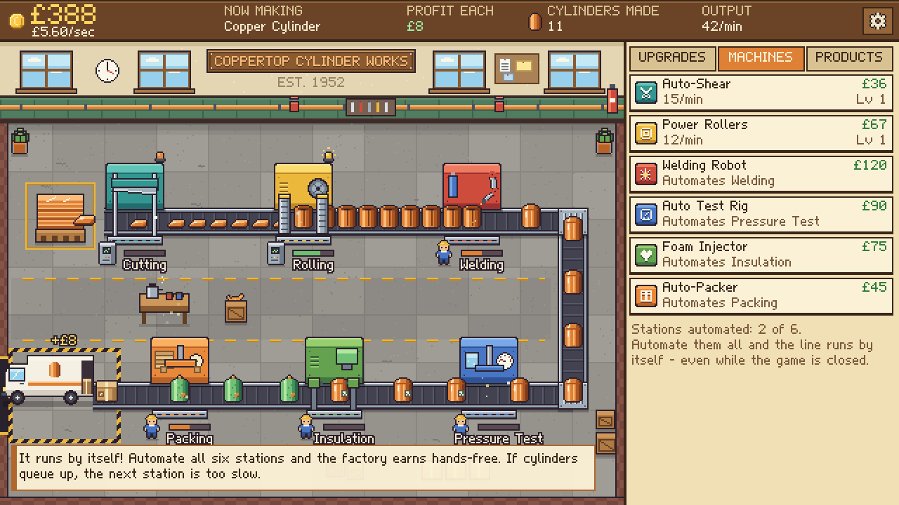
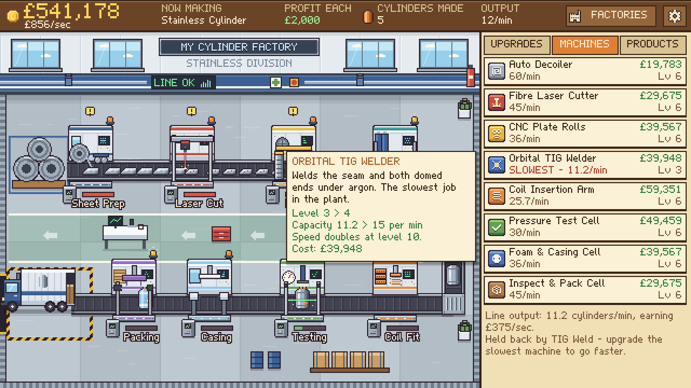
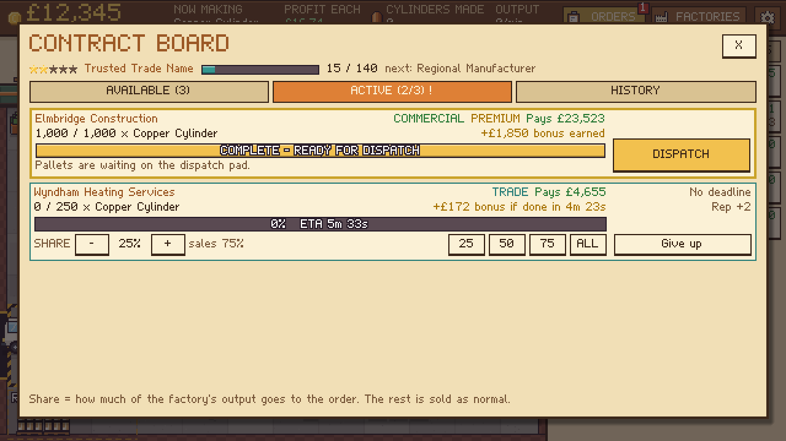
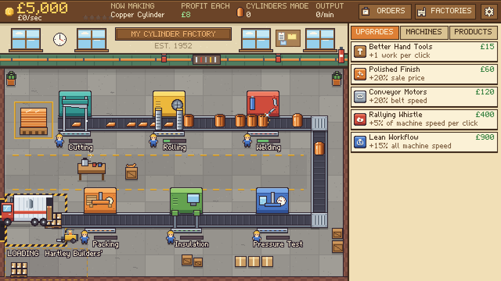
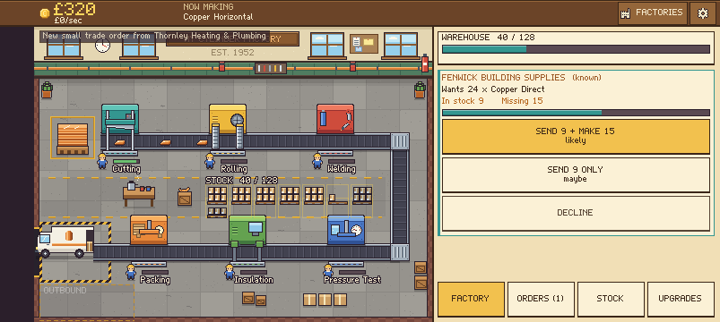
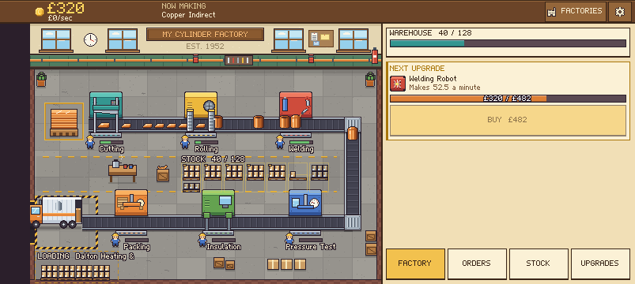
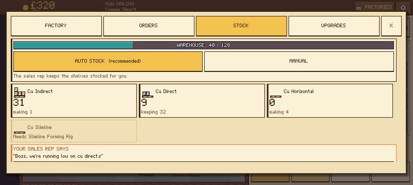
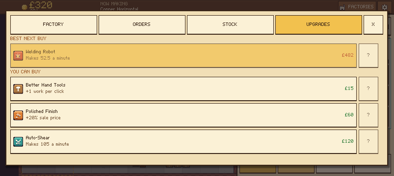

# Cylinder Clicker

A cosy 2D pixel-art factory idle game. You run **Coppertop Cylinder Works**, a small British
hot water cylinder factory that you name yourself: click to work the line, sell copper cylinders, buy machines and
watch the factory slowly learn to run itself - then take on **customer contracts**, commit part of your
production to them and send a lorry out to collect the order.

Built with **Godot 4.7 + GDScript**. Runs on **Windows** and **Android** (landscape) from the same
code. Fully offline, local saves only, no ads, no accounts, no third-party assets.









## How to play it

**Easiest: download from the Releases page**

Open the repository's **Releases** page on GitHub and pick the latest release.

- **Android phone or tablet:** download `CylinderClicker-<version>-android.apk` on the phone and open
  it. The first time, Android asks you to allow your browser (or Files app) to install apps - allow
  it, then tap Install. The game is landscape only, needs no permissions and works offline.
- **Windows:** download `CylinderClicker-<version>-windows.zip`, unzip it and double-click
  `CylinderClicker.exe`. Windows may show a "Windows protected your PC" notice because the exe is
  not code-signed: choose *More info* > *Run anyway*.

Every push also builds both versions: open the **Actions** tab, pick the latest green run and
download the `CylinderClicker-android` or `CylinderClicker-windows` artifact.

**Run from the project**

1. Download Godot **4.7.x** (standard version) from <https://godotengine.org/download/windows/>.
   It is a single exe - no installer.
2. Start Godot, choose **Import**, select this folder's `project.godot`, then press **F5**.

### Moving a save between Windows and Android

Saves are stored separately on each device (`%APPDATA%\CylinderClicker\savegame.json` on Windows,
the app's private storage on Android). To carry a factory across:

1. On the old device open the main menu, choose **Transfer Save** > **Copy save code**.
2. Paste the code into an email or message to yourself.
3. On the new device copy that code, open **Transfer Save** and choose **Paste save code**.

The old device keeps its save; nothing is deleted.

### Android signing

Android only lets a new APK update an installed one if both are signed with the same key. The
release APKs are signed with the project's permanent key, which is **not** stored in this
repository. To let GitHub sign builds with it, add these repository secrets
(Settings > Secrets and variables > Actions):

| Secret | Value |
| --- | --- |
| `ANDROID_KEYSTORE_BASE64` | the keystore file, base64-encoded |
| `ANDROID_KEYSTORE_PASSWORD` | the keystore password |
| `ANDROID_KEY_ALIAS` | `cylinderclicker` |

Without them, builds from the Actions tab are signed with a throw-away key and named
`...-android-testkey.apk`; a Release then publishes the pre-signed APK from `releases/android/`
for that version if there is one. Once the secrets are set, `releases/android/` is no longer needed.

## Controls

On Android everything is done by touch: tap the factory to work (two thumbs both count), tap a
shop row to buy, **press and hold a row** for its details, drag the shop to scroll, and use the
phone's **Back** button or gesture for the pause menu.

| Input | Action |
| --- | --- |
| Left-click the factory floor, or **Space** | Work every station (the core click) |
| Click a shop row | Buy that upgrade / machine |
| Hover a shop row | Tooltip with what it does and what the next level gives |
| **1 / 2 / 3** | Upgrades / Machines / Products tabs |
| **F** or the FACTORIES button | Factory overview: see every factory, switch between them, build new ones |
| **C** or the ORDERS button | The Contract Board: customer offers, your accepted contracts, production shares, dispatch |
| **Esc** or the gear button | Pause menu (resume, save, settings, rename factory, return to main menu, quit) |
| **F11** | Toggle fullscreen |

## Warehouse, stock control and customer relationships









**Playing it (0.7.0).** The main screen is the factory plus a side deck: how full the warehouse is, *one thing to do*
(a customer's order card when somebody is on the phone, otherwise the best next upgrade) and four destinations -
**FACTORY | ORDERS | STOCK | UPGRADES**. Everything else is automatic or behind **MORE DETAILS**. See `docs/ux-audit.md`
for what was simplified and why.

Since 0.6.0 a cylinder is no longer sold the moment it is made. The loop is: **manufacture > store in the
warehouse > customers telephone > fulfil, part-fulfil or refuse > dispatch > earn > grow.**

- **The warehouse.** Every factory has its own stock room with a limited capacity (24 cylinders to start
  with, 12 at the stainless plant), per-product stock, *reserved* (promised to a customer) and *available*
  counts, and a visible fill bar. Finished cylinders are built into stock; they only earn money when they
  leave: on a lorry for a customer, or to the wholesaler. The racking on the factory floor grows with the
  warehouse (more bays, then stacked tiers), fills with pallets as stock arrives and carries a gold tag on
  pallets set aside for a customer. **Bigger Warehouse** (+75% per level, each level dearer) is in the shop.
  When the shelves are full the line stops - or, with *Wholesale surplus* on, a person at the controls may
  keep building and the surplus is sold to the wholesaler at about 85% of normal profit. Cylinders are never
  silently deleted: `made = in stock + shipped + wholesaled` is checked by the tests through whole playthroughs.
- **Products.** Copper and stainless each come in Indirect and Direct, then Horizontal and (copper) Slimline once
  the specialist tooling is bought (Horizontal Tooling, Slimline Forming Rig, Horizontal Handling Cell). Each
  has its own price, material and making costs and build time (`data/skus.json`). Premium variants sell for
  more each but never earn more *per minute of line time* than the standard one, so the best plan is led by demand.
- **Production planner.** Customers who are waiting come first (earliest promise first), then the product
  furthest below its **target stock**. Targets follow the sales rep's recommendation (AUTO TARGETS) or are set
  by hand: on the **STOCK** screen choose **AUTO STOCK** (the default: the game decides what to make) or **MANUAL**
  (+/- per product). A person clicking can stockpile beyond the targets. Offline, the same planner runs in half-minute steps.
- **Telephone orders.** Persistent customers ring for a product and a quantity ("Can you supply 18 Copper
  Direct?"). An order card appears beside the factory with at most three buttons: **SEND 5 + MAKE 5** (part delivery now; the
  rest is queued, built with priority and shipped in later lorries against a promised date), **SEND 5 ONLY**, **DECLINE** - or a
  single **FULFIL ORDER** when everything is in stock. Each offer hints how likely the customer is to accept, and the result
  is shown as feedback ("Customer happy! +3 relationship", "Delivery late! Customer unhappy."). Customers differ in patience, how much they mind part deliveries, and price sensitivity.
  If nobody answers, your sales rep takes the call at a weaker price - which is also what keeps the factory
  selling while you are away.
- **Orders are contracts.** A telephone order is an ordinary entry in the Contract Board with a product, ordered /
  reserved / shipped / outstanding quantities and its own lorries, so there is one order system, one set of
  reservations and one dispatch (lorry and forklift). Board contracts are filled from stock too, ship by themselves when finished
  and can go in several lorries (paid per lorry; the bonus and reputation come when the last one has left).
- **Customers and relationships.** Each customer has a relationship score (New, Known, Regular, Trusted,
  Partner), order history, total spend, preferences, typical order size, price sensitivity and patience.
  Trust brings bigger and more frequent orders, a better price (up to about +16%) and more patience. Loyalty
  grows slowly and its ceiling depends on how many orders you have really completed, so two tiny orders never make
  a partner. Late or cancelled orders and repeated refusals cost relationship, and a customer who is turned away
  too often stops ringing for a while. *Company reputation* (the stars) is separate and unchanged.
- **Sales rep.** A helpful assistant on the STOCK screen: "Boss, we're running low on copper indirects" [RESTOCK RECOMMENDED],
  "We're missing orders because the warehouse is full" [UPGRADE WAREHOUSE], "Customers are waiting for 12 cylinders"
  [FOCUS ON BACKORDERS]. Underneath it still forecasts the likely share of calls per product, a recommended stock level,
  shortfalls, lost sales and stock nobody is buying (MORE DETAILS shows the full report). It is a likelihood, not a promise,
  and **Sales Rep Training** makes it follow what customers really ask for. New products rebalance it the moment they unlock.
- **Old saves.** A v0.5.1 save is brought across automatically (save version 5): upgrades, money, unlocks and
  factories are untouched; each factory gets a warehouse big enough for its output and automatic targets; cylinders
  that had been built for an open contract become reserved stock for it, so no progress is lost and nothing is paid
  twice. `--direct-sales` on the command line keeps the old sell-on-completion rules (the tests that pin them use it).
- **Balance.** `tests/stock_economy_sim.gd` plays the real game with simulated players (skilled, average, careless,
  blind) against v0.5.1; see `docs/expansion-4-plan.md` for the numbers. Everything about warehouses is in
  `data/skus.json`, customers and calls in `data/customers.json`.

## Trade contracts, customer orders and dispatch

(In the warehouse game, accepting a board contract puts the cylinders on the shelves aside for it and the line builds the rest - there are no output shares; see above. This section describes the v0.5.1 rules, which `--direct-sales` still uses.)

Once the company has made a few sales, customers start sending in orders: installers, plumbing
suppliers, builders' merchants, wholesalers, developers and housing associations, each with a name,
a quantity, a price, a deadline and a reward. Open the **Contract Board** (the ORDERS button, or **C**).

- **Three kinds of order.** *Small Trade Orders* are small and early. *Commercial Contracts* need
  Local Supplier reputation and real capacity. *Major Supply Agreements* need Regional
  Manufacturer reputation and a big factory. Orders are sized from what your factory can *really*
  build (its hands-free rate, or a click-assisted estimate while it is not automated yet), so an
  offer is never out of reach, and deadlines are always several times the full-speed build time.
- **Production allocation.** Accepting an order commits a share of that factory's output to it
  (50% by default; a new order never takes the last 20%). Every cylinder the factory makes -
  clicked or automatic, on screen or not - is split exactly by those shares: the contract's share
  goes into the order and earns no sale revenue, the rest is sold as before. Change a share any
  time with the **-** / **+** buttons or the 25 / 50 / 75 / ALL presets. Each factory has its own
  100% to allocate, and switching factories never interrupts anything.
- **Dispatch.** A finished order waits as pallets on the dispatch pad below the bay. Press
  **DISPATCH**: the standing vehicle pulls out, a delivery lorry (orange, green or red by size of
  order) reverses into the bay, a forklift loads the pallets, the lorry drives away - and you are
  paid, with reputation and any bonus, exactly once, as it leaves.
- **Pricing.** An order pays *quantity x what a cylinder nets today x its margin*. The price follows
  your list price (Polished Finish and cost savings raise it), so a contract's premium over selling
  (typically +10% to +40%, more for premium customers, a little less for wholesalers' volume deals) is the same
  however fast you grow. Finishing early earns the bonus.
- **Deadlines.** Time left is shown on every order. Miss one and you lose a little reputation
  (never a rank you have already earned), the bonus, and premium customers pause for 15 minutes; the
  cylinders already built are simply sold at the normal price, so nothing is wasted. While you are
  away deadlines run only for factories that run unattended - the same rule and the same 8 hour limit
  as offline earnings - and the welcome-back summary lists every order's progress.
- **Reputation.** Six ranks, from *Unknown Workshop* to *Industry Name*, shown as stars next to your
  cash. Higher ranks open commercial then major contracts, a bigger board, better prices, occasional
  premium customers and a fourth contract at once. Small orders stop adding reputation as you outgrow
  them, so it cannot be ground out.
- **The choice.** Orders pay a premium but pay it *later*, and the share you commit stops selling
  meanwhile. Sensible play (a couple of short orders at a time) pulls ahead; promising everything
  starves your upgrades. The Contract Board warns you when a factory is nearly fully committed.

Everything about customers, ranks and tiers is in `data/contracts.json`.

## What is in the game

- **Two factories.** The Copper Cylinder Works you start with, and the Stainless Steel Plant: a
  second building with its own eight-stage line (Sheet Prep, Laser Cut, Rolling, TIG Weld, Coil
  Fit, Testing, Casing, Packing), its own machines, upgrades, artwork and statistics. It costs
  £1,000,000 to build once the copper works is fully automated and has earned £500,000.
- Every factory you own keeps producing whichever one is on screen, and all sales go into one
  company cash balance. Offline earnings cover every automated factory.
- Stainless cylinders sell for far more but carry material and manufacturing costs, take much
  longer to build and need expensive machines - slow at first, more profitable in the long run.

- One copper cylinder production line with six stations: Cutting, Rolling, Welding,
  Pressure Test, Insulation, Packing, then dispatch to the van.
- Cylinders are visible objects that ride the conveyors and change appearance at each stage
  (sheet > cut sheet > rolled tube > welded cylinder > tested > blue foam-insulated > boxed).
- Clicking adds work at every station. Each station can be automated with its own machine,
  and each machine can be levelled up (speed doubles at levels 10, 25, 50...).
- Real bottlenecks: belts are the buffers, so a slow station makes cylinders queue up behind
  it, blocks the station before it (yellow **!**) and starves the ones after. The Machines
  tab names the slowest machine once the line is fully automated.
- Upgrades: Better Hand Tools (faster production), Polished Finish (higher selling value),
  Conveyor Motors, Rallying Whistle (keeps clicking useful late on) and Lean Workflow.
  Later ones reveal themselves as your lifetime earnings grow.
- Economy: sale price minus material cost = profit per cylinder; exponential upgrade costs.
- Main menu (New Game, Continue, Settings, Quit) and an in-game pause menu on Esc that
  freezes the factory while it is open.
- Name your factory when you start; the name is painted on the wall sign and can be changed
  from the pause menu.
- Saving: manual save from the pause menu, autosave every 30 seconds, and on returning to
  the menu or quitting. Saves include the cylinders currently on the line, keep a backup
  copy and use a versioned format (older saves are migrated).
  Saves live in `%APPDATA%\CylinderClicker\savegame.json`.
- Offline progress: a fully automated line keeps earning while the game is closed (up to
  8 hours), with a welcome-back summary.
- Tutorial hints, sound effects, a music loop, floating cash pop-ups and particles.
- Products tab showing the planned ranges (Thermal Stores, Stainless Steel, Pre-Plumbed and
  the specialist variants) as locked - the data model for combining them already exists.

## Project layout

```
data/        JSON definitions - edit these to rebalance or add content
  contracts.json  customer contracts: ranks, tiers, customers, margins, deadlines, dispatch timing
  factories.json  the factory buildings, their unlock requirements and cost
  stations.json / upgrades.json                      the copper works' line and upgrades
  stainless_stations.json / stainless_upgrades.json  the stainless plant's line and upgrades
  products.json   materials x ranges x variants (products are composed, not hard-coded)
scripts/core/     pure game logic - no nodes, no rendering (fully unit-tested)
  production_line.gd   deterministic line simulation (stations, belts, batching)
  game_session.gd      the company: shared cash, every factory, unlocking, offline progress
  factory_sim.gd       one factory: its upgrades, economy and production line
  factory_def.gd       a factory's data definition; factory_state.gd its saved state
  stat_block.gd        turns upgrade levels into stats
  product_catalog.gd   composes products from parts
  contract_book.gd     trade contracts: reputation, the board, allocation routing, deadlines, dispatch, offline
  contract_generator.gd  reproducible customer orders from (seed, serial, market snapshot)
  contract_rules.gd / contract.gd  the contract data and its rules lookups
  save_manager.gd      versioned saves with migration and backup
  num_format.gd        number/currency formatting (K, M, B ... then scientific)
scripts/autoload/ Game (fixed-timestep loop, saving, menu/game switching) and Sfx (audio)
scripts/menu.gd   main menu; scripts/main.gd is the factory scene
scripts/view/     factory_view.gd - draws the factory from the simulation state; dispatch_yard.gd - the
                  pallet pad and the delivery sequence
scripts/ui/       HUD, shop, tutorial, dialogs, theme
assets/           generated sprites, font and audio
tools/            Python generators for all art, the font and the audio
tests/            headless tests, a balancing bot and a screenshot bot
```

### Architecture notes

- **Simulation is separate from rendering.** `GameSession`, `FactorySim` and `ProductionLine`
  never touch the scene tree; `FactoryView` only reads the one factory on screen. All unlocked
  factories are ticked every step, so switching view cannot lose or duplicate production.
- **Adding a factory is mostly data:** an entry in `factories.json`, a stations file, an upgrades
  file and its sprites (named in the stations file's `view` block). The same logic runs in the game, the tests
  and the balancing bot.
- **Scaling.** A token on the belt is a *batch* of cylinders. Early on a batch is exactly one
  cylinder. When machines could exceed about two items per second, each new item carries
  proportionally more cylinders instead, so the number of simulated and drawn objects stays
  small no matter how large production becomes (tested at roughly 100,000 cylinders/min).
- **Big numbers.** Values are 64-bit floats (up to about 1e308), clamped at 1e300 and always
  formatted through `NumFmt`. If that is ever outgrown, only `NumFmt` and the arithmetic in
  `GameSession` need to change.
- **Contracts are part of the same simulation.** Every cylinder a factory ships, and every offline
  catch-up, passes through one door (`ContractBook.route` / `offline_factory`) that splits it between
  contracts and sales, so manual, automatic and offline production share one set of rules and nothing
  is counted twice (made = sold + contracted, tested through whole playthroughs). With no active
  contract the split returns 0 and the old arithmetic is untouched: a scripted 30-minute playthrough
  plus 2 hours away is identical to v0.4.0 to the last bit (`tests/golden_v0_4_0.json`). The dispatch
  timer lives in the simulation (saved, resumable); `DispatchYard` only animates it. Contract
  generation is a pure function of `(seed, serial, market snapshot)`, and uses factory ids and
  composed products, never copper or stainless by name, so new factories and products get orders
  without code changes.
- **One game, two platforms.** Android uses the same scenes and scripts. The layout is computed
  from the screen size (640x360 gives the desktop arrangement exactly; a phone's wider screen
  gives the shop more room), and `UiTheme.touch` switches on finger-sized controls.
- **Determinism.** The simulation runs on a fixed 60 Hz step; identical inputs give identical
  results. Offline earnings use the analytic bottleneck rate.
- **Saves are versioned.** `SaveManager` upgrades old saves step by step, ignores unknown
  upgrades and refuses saves from a newer version. Version 4 adds the contract book (reputation,
  offers, accepted contracts with progress, shares and deadlines, history); version 5 adds the warehouse
  (per-factory stock, reserved, counters, targets, priorities), the sales office (customers, relationships,
  waiting calls, forecast history) and the order fields; older saves load and migrate step by step.
- **Warehouse accounting.** Cash only ever moves by net profit at the moment of sale (price less the product's
  material and making cost), so production never needs money up front and a player can never be stranded. The
  `Warehouse` keeps whole-unit stock, reserved and fractional carry; `StockPort` is the contract book's only way
  to reserve, release or ship it; `SalesOffice` owns customers, calls and the forecast and creates ordinary
  `Contract`s; `FactorySim` hosts the planner. None of them touch the scene tree.

## Development

```bash
godot --headless --path . --import                 # first time only
godot --headless --path . -s tests/run_tests.gd    # logic tests
tests/run_save_flow.sh                             # real save > quit > load > offline flow
tests/run_menu_flow.sh                             # menus, naming, pause, saving and restart, end to end
tests/run_expansion_flow.sh                        # old save > build stainless > switch > restart > offline
godot --headless --path . -s tests/run_contract_tests.gd   # contracts: generation and balance, allocation, dispatch, reputation, deadlines, offline, saves
tests/run_contracts_flow.sh                        # old save > orders > shares > dispatch > restart mid-dispatch > two hours away (needs xvfb)
tests/run_touch_flow.sh                            # phone layout, touch input (including the Contract Board), Android pause/resume (needs xvfb)
tests/android/run_emulator_test.sh                 # the same inside the real APK on an emulator (run by CI)
```

Screenshots from the real Android emulator run are in `docs/android/` (add `[android-screenshots]`
to a commit message to refresh them).

```bash
godot --headless --path . -s tests/balance_bot.gd  # pacing report from a simulated player
godot --headless --path . -s tests/contract_balance_bot.gd -- --hours=2   # the same game under different contract policies
python3 tools/gen_art_contracts.py                 # regenerate the pallet, forklift, lorry and icon sprites
python3 tools/gen_audio_contracts.py               # regenerate the dispatch sounds (needs numpy)
python3 tools/gen_art.py                           # regenerate sprites (needs Pillow)
python3 tools/gen_art_stainless.py                 # regenerate the stainless plant sprites
python3 tools/gen_font.py                          # regenerate the pixel font
python3 tools/gen_audio.py                         # regenerate audio (needs numpy; music is then converted to .ogg with ffmpeg)
```

## Assets and licences

Everything in `assets/` is original to this project and generated by the scripts in `tools/`:
the sprites are drawn procedurally, the pixel font was hand-authored glyph by glyph, and the
sounds and music are synthesised from oscillators. There are **no third-party assets**.
The game runs on the Godot Engine (MIT licence).

## Roadmap (not in this version)

- More factories: Thermal Stores, Pre-Plumbed and the specialist variants (contracts will pick them up).
- Larger company contracts and supplier purchasing and negotiation for material costs.
- Buy-multiple buttons, achievements, more ambience and animation.
